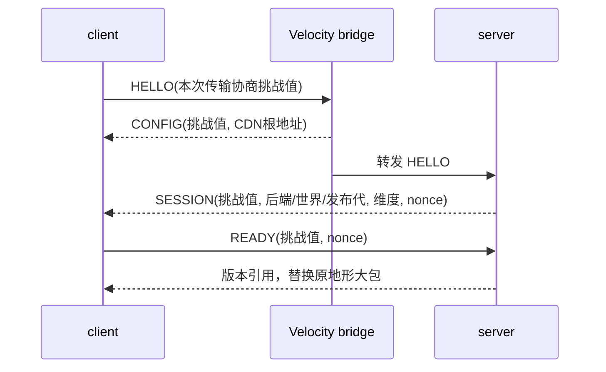

# 协议与兼容边界

## 控制通道 v2

可选自定义 payload：客户端 → 后端 `vsscdn:control`，后端/bridge → 客户端 `vsscdn:delivery`。Velocity 只处理来自玩家、发往后端的 HELLO，发送自己的 CONFIG 后继续转发 HELLO。



CONFIG 与 SESSION 可任意先后到达；只有挑战值和当前维度匹配且二者齐备才启用。等待 100 tick 失败则放弃 HTTP 协商；原 VSS 在等待期间照常运行。切服、切维度、退出及脏坐标会清理或取消相关下载；旧异步回调不能写入新会话。

alpha.3 bridge 若识别到 `Player.getRemoteAddress()` 来源属于 `192.168.0.0/16` 且 `lan.direct.enabled=true`，用 `DIRECT_CONFIG=7` 代替 CONFIG=5，载荷同样为挑战值和根地址。客户端仍等待该配置与 SESSION，以校验 HTTP 会话，随后发送 DISABLE 而不发送 READY，不启动 HTTP 下载。公网来源继续执行上图的 CONFIG/READY 流程，CONFIG 字节格式不变。客户端不依据入服域名/目标地址作选择，后端无需推测代理后面的玩家地址。

新消息沿用控制 v2。旧客户端忽略未知 kind，5 秒未得到 CONFIG 后回退原生 VSS；新客户端收到 alpha.2 bridge 的 CONFIG 时继续 CDN。完整 LAN 路由需要新 bridge 和新客户端，后端 alpha.2 可继续使用。来源被上游 NAT/隧道改写时不能自动恢复，必须在网络侧保留或可信地转发原始来源。

每次 HTTP 尝试有 10 秒完整响应期限，超时会取消底层请求。HTTP 503 会按 250 毫秒、500 毫秒的间隔最多重试两次。仍失败时停用本次会话的 CDN 接管，由原生 VSS 重新请求未完成坐标。回退保留已有列的时间戳，切服时取消下载及待重试任务。兼容性接口集中在 `LssAccess`，当前针对 VSS 协议 20。

## 对象与 HTTP/TCP v1

```text
/lod/v1/<backendUUID>/<worldUUID>/<epochUUID>/<base64url维度>/<x>/<z>/<revision>.bin
```

- `revision` 是持久化、全局递增的正整数，不是内容哈希；每次预留 1024 个，允许崩溃后跳号。
- 同一坐标的 codec、原始大小和字节都不变时复用旧 URL，同时按小时刷新服务端的保留时间。
- 发布文件损坏或丢失时，服务端在收到 VSS 提供的列数据后使用新 revision 重建。旧 URL 仍代表原版本。
- 成功响应是带身份、codec、长度及 CRC32C 的二进制 envelope。CRC 用于传输损坏检查，不是签名或下载授权。
- codec 0 为原字节，codec 1 为既有 VSS 压缩帧。本项目沿用 VSS 的编码字节。服务端仅接管使用当前 VSS 协议且已协商压缩能力的玩家的列，其余列走原生 VSS。
- 原始/压缩体各有 2MiB 上限；客户端同时最多 8 个 HTTP 下载，待处理上限 4096 列/1GiB 原始大小预算。
- HEAD 读取完整后端对象后返回长度，没有 Range、206 或条件式 304 实现。

TCP 为 big-endian DataInput/DataOutput，UUID 为两个 long，字符串为 Java modified UTF-8。后端先发送 magic `0x56534344`、版本 1、后端 UUID、32字节随机挑战；bridge 返回 `HMAC-SHA256(secret, nonce || ASCII(backendUUID))`。鉴权后命令 0 为 ping，命令 1 读取完整 ColumnKey；状态 0/1/2 分别表示成功/对象不存在/读取错误。

TCP 数据不加密，密钥鉴权不限制已获对象 URL 的玩家访问。跨公网的后端连接应放入加密隧道；玩家级 URL 鉴权不在当前实现内。HTTP 使用 HTTPS 时可保护玩家到 CDN 这一段，回源与后端段需分别配置。

## 原生世界管理与传输去重

alpha.5 采用 VSS/Voxy 默认世界识别、缓存键和地形目录，不改写 `WorldIdentifier`，也不设置跨入服地址收据映射。后端/世界/发布代 UUID 只用于 URL 和 HTTP 响应校验；发布代变化不会改变原生地形缓存身份。不同服、维度、种子或地址如何隔离，均遵循原实现。

HTTP 与原生数据回注同一个 `ClientNetGlue.onVoxelColumnFrame`，继续使用原解码、入库、失败和收据流程。HTTP 引用只读取当前 VSS 收据：时间戳匹配、状态 SATISFIED 且缓存加载完成时可跳过数据体；正时间戳本身不能证明入库成功。

同一 URL 的在途引用共享一个下载任务，回注使用该任务收到的最新时间戳和来源。

切服取消本组件的队列和 future，HTTP 回调核对 level 对象、VSS 请求管理器归属及 ticket。VSS 自行更换管理器时，也只退休旧 HTTP 工作。补丁不重新握手 VSS、不刷新 Voxy 渲染器、不阻塞等待协商期间的原生数据。原生包到达可取消 HTTP；旧正时间戳不能覆盖更新数据，特殊空列/控制语义保留。

alpha.2–alpha.4 的 scoped 缓存不自动迁移到原生缓存键；升级后可能需要首次重新下载，旧数据保留便于回滚。

外部参考：[VSS 1.21.1 源码](https://github.com/VoX/lod-server-support/tree/support/mc1.21.1)。
